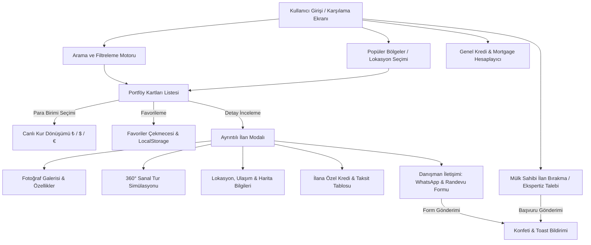

# 🏰 COMODO EMLAK - Seçkin & Lüks Gayrimenkul Platformu

[](https://comodo-teknoloji-ve-ticaret.github.io/EMLAK/)
[](https://vitejs.dev/)
[](https://react.dev/)
[](https://www.typescriptlang.org/)

**Comodo Emlak**, Türkiye'nin ve dünyanın en seçkin bölgelerindeki lüks villa, penthouse, tarihi yalı ve akıllı rezidans portföyünü yatırımcılarla buluşturan modern bir gayrimenkul platformudur.

Bu proje, **GitHub Pages** üzerinde kesintisiz çalışacak şekilde yapılandırılmış olup, tam tip güvenli **TypeScript**, **React 19** ve **Vite** altyapısıyla geliştirilmiştir.

---

## 🧭 Projenin Uçtan Uca Akışı (Workflow)

Aşağıdaki şema ve maddeler, bir ziyaretçinin veya yatırımcının platform üzerindeki etkileşim adımlarını ve arka plan iş akışını göstermektedir:



### 1. Karşılama ve Hızlı Keşif Akışı (Hero Section)
- Ziyaretçi siteye girdiğinde 2026 lüks gayrimenkul koleksiyonu, atmosferik aydınlatma ve güven metrikleri ile karşılanır.
- Hızlı arama çubuğunda **Satılık / Kiralık** durumu, **Şehir**, **Konut Türü** veya **Özgür Anahtar Kelime** seçilerek anında portföy taraması başlatılır.

### 2. Canlı Filtreleme ve Çoklu Para Birimi Akışı
- Ziyaretçiler arama kriterlerini anlık olarak daraltabilir (oda sayısı, sıralama, şehir).
- Üst menüdeki para birimi değiştirici (₺ TRY, $ USD, € EUR) tıklandığında, sayfadaki tüm ilan fiyatları canlı olarak güncel döviz kurlarına göre yeniden hesaplanır ve biçimlendirilir.
- Koyu ve Açık tema desteği sayesinde kullanıcı tercihine göre görsel deneyim kişiselleştirilir.

### 3. Ayrıntılı İlan İnceleme ve 360° Deneyim Akışı
- Bir ilana tıklandığında zengin `PropertyDetailModal` açılır.
- **Galeri**: Yüksek çözünürlüklü mimari fotoğraflar arasında geçiş yapılır.
- **360° Sanal Tur**: Mülkün iç ve dış mekanlarını interaktif simülasyonla gezme imkanı sağlanır.
- **Lokasyon & Ulaşım Analizi**: Harita koordinatları, metro, sahil, havalimanı ve hastanelere olan mesafeler sunulur.
- **Ödeme Planı**: Seçilen mülkün peşinat ve vade oranlarına göre aylık taksit hesaplaması yapılır.

### 4. Randevu ve Danışman İletişim Akışı
- Ziyaretçi doğrudan ilandan sorumlu kıdemli danışmana **WhatsApp** üzerinden hazır referans mesajıyla ulaşabilir veya telefonla arayabilir.
- "Özel Sunum & Randevu Formu" doldurularak tercih edilen gün ve saat dilimi için randevu iletilebilir. Gönderim sonrası mikro konfeti animasyonu ve toast bilgilendirmesi tetiklenir.

### 5. Favoriler ve Karşılaştırma Akışı
- İlan kartlarındaki kalp simgesine tıklandığında mülk favorilere eklenir.
- Favoriler tarayıcının `localStorage` hafızasında saklandığından sayfa yenilense dahi korunur.
- Sağdan açılan çekmeceden favori ilanlar incelenebilir veya tek tıkla temizlenebilir.

### 6. Mülk Sahibi İlan Bırakma Akışı (Add Listing)
- Kendi dairesini veya villasını satmak/kiralamak isteyen gayrimenkul sahipleri "İlan Bırak" butonuna tıklayarak mülk özelliklerini ve iletişim bilgilerini paylaşır.
- Başvuru ekspertiz ekibine iletilir ve kullanıcıya anında onay bildirimi verilir.

---

## 📁 Proje Klasör Yapısı

```
EMLAK/
├── .github/
│   └── workflows/
│       └── deploy.yml          # GitHub Pages otomatik dağıtım iş akışı
├── frontend/                   # TypeScript + React + Vite önyüz uygulaması
│   ├── dist/                   # Canlıya hazır derlenmiş dosyalar (index.html, 404.html, assets)
│   ├── public/                 # Statik varlıklar
│   ├── scripts/
│   │   └── copy-404.js         # GitHub Pages SPA 404 yönlendirme desteği
│   ├── src/
│   │   ├── components/         # Modüler UI bileşenleri (Navbar, Hero, PropertyCard, vb.)
│   │   ├── data/               # Gerçekçi lüks portföy ve danışman verileri
│   │   ├── styles/             # Tasarım sistemi
│   │   ├── types/              # Kapsamlı TypeScript arayüz ve tip tanımları
│   │   ├── utils/              # Para birimi biçimlendirici ve mortgage formülleri
│   │   ├── App.tsx             # Ana uygulama durum yönetimi
│   │   ├── App.css             # Bileşen stilleri ve medya sorguları
│   │   ├── index.css           # Tasarım tokenları, renk değişkenleri ve cam efekti
│   │   └── main.tsx            # Uygulama giriş noktası
│   ├── package.json            # Bağımlılıklar ve derleme betikleri
│   ├── tsconfig.json           # TypeScript yapılandırması
│   ├── vite.config.ts          # Vite ve GitHub Pages base path ayarı
│   └── README.md               # Frontend detaylı işlem günlüğü
├── backand/                    # Gelecekteki backend servisleri için ayrılmış dizin
└── README.md                   # Genel proje dokümantasyonu ve mimari akış
```

---

## 🌐 GitHub Pages Üzerinden Yayına Alma

Bu proje, GitHub Pages üzerinde hem **otomatik (CI/CD)** hem de **manuel** yöntemle yayınlanacak biçimde tam uyumlu olarak ayarlanmıştır:

### Yöntem 1: GitHub Actions ile Otomatik Dağıtım (Önerilen)
Depoda bulunan [`.github/workflows/deploy.yml`](file:///.github/workflows/deploy.yml) dosyası sayesinde, her `main` dalına push yapıldığında proje otomatik olarak derlenir ve GitHub Pages'e yüklenir:

1. GitHub deponuzun sayfasına gidin: `https://github.com/Comodo-Teknoloji-Ve-Ticaret/EMLAK`
2. **Settings** (Ayarlar) sekmesine tıklayın.
3. Sol menüden **Pages** bölümüne gelin.
4. **Build and deployment > Source** seçeneğini **`GitHub Actions`** olarak belirleyin.
5. Kodlarınızı `main` dalına push ettiğinizde sayfanız birkaç dakika içinde şu adreste yayında olacaktır:
   👉 **`https://comodo-teknoloji-ve-ticaret.github.io/EMLAK/`**

### Yöntem 2: `gh-pages` ile Manuel Dağıtım
Eğer terminal üzerinden doğrudan tek komutla yayına almak isterseniz:

```bash
cd frontend
npm run deploy
```

Bu komut önce projeyi derler (`npm run build`), ardından oluşan `dist` klasörünü otomatik olarak deponuzun `gh-pages` dalına yükler. Bu yöntemi kullanırken GitHub Pages ayarlarında kaynak olarak `Deploy from a branch` ve `gh-pages / (root)` seçilmelidir.

---

## 💻 Yerel Geliştirme (Local Development)

Projeyi kendi bilgisayarınızda çalıştırmak için:

```bash
# 1. Frontend dizinine geçin
cd frontend

# 2. Gerekli paketleri kurun
npm install

# 3. Geliştirme sunucusunu başlatın
npm run dev
```

Tarayıcınızda açılan adrese (`http://localhost:5173`) giderek projeyi anlık canlı yenileme (HMR) ile test edebilirsiniz.

---

## 📄 Lisans & Telif Hakkı
Bu proje **Comodo Teknoloji ve Ticaret** bünyesinde geliştirilmiştir. Tüm hakları saklıdır.
